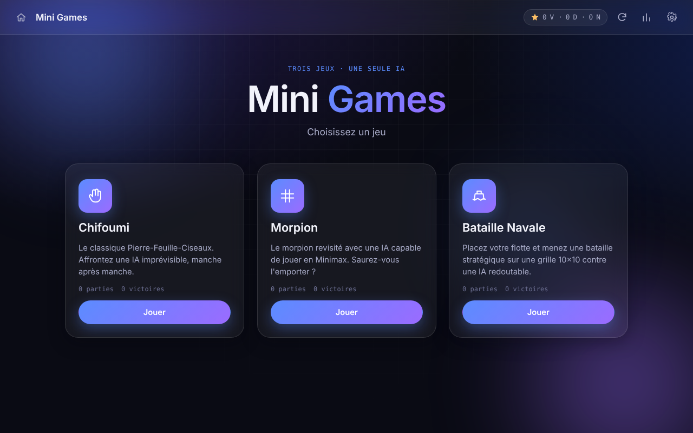
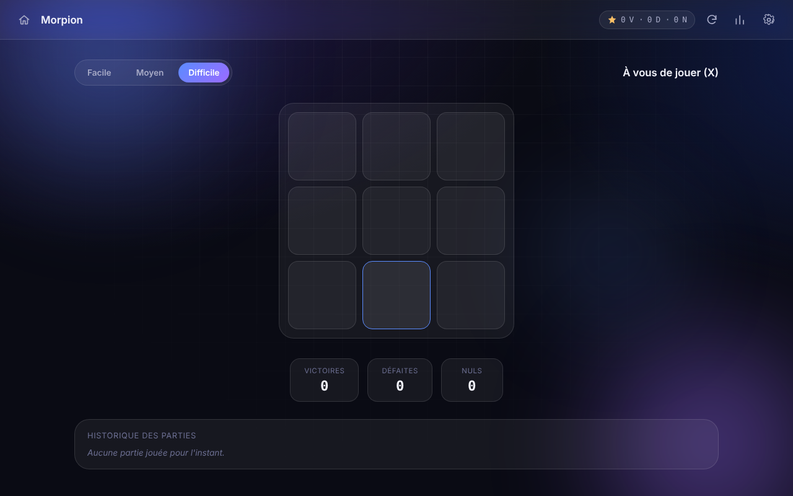

# 🎮 Mini Games — Défiez l'IA

Un site web **100% local**, sans serveur ni base de données, qui réunit trois mini-jeux jouables contre une intelligence artificielle : **Chifoumi**, **Morpion** et **Bataille Navale**.

Construit uniquement en **HTML5 / CSS3 / JavaScript Vanilla (ES6+)** — aucun framework, aucune dépendance à installer.

---

## ✨ Fonctionnalités

- 🪨 **Chifoumi** — Pierre / Feuille / Ciseaux contre une IA aléatoire, avec animation de réflexion, historique des 10 dernières manches.
- ❌ **Morpion** — 3 niveaux de difficulté (Facile / Moyen / Difficile), l'IA en mode Difficile utilise l'algorithme **Minimax** et ne perd (quasiment) jamais.
- 🚢 **Bataille Navale** — Grilles 10×10, placement manuel des bateaux (rotation, aperçu, placement aléatoire), IA de tir en mode **chasse / cible** qui ne tire jamais deux fois au même endroit et termine un bateau avant d'en chercher un autre.
- 💾 **Sauvegarde locale automatique** via `localStorage` : parties, victoires, défaites, égalités, meilleure série, statistiques par jeu.
- 🔊 **Effets sonores** générés directement en JavaScript via la Web Audio API (clic, victoire, défaite, égalité, placement, touche, explosion) — aucun fichier audio à télécharger.
- 🎨 **Interface moderne** : glassmorphism léger, dégradés animés, coins arrondis, transitions fluides, confettis CSS en cas de victoire, vibration de l'écran en cas de défaite.
- ⚙️ **Paramètres** : mode sombre / clair, volume, activation des sons, activation des animations, réinitialisation des statistiques ou réinitialisation complète.
- 🏆 **Succès (achievements)** : 8 succès à débloquer (première victoire, 10 victoires, 100 parties, série de 5 victoires, battre l'IA du Morpion en difficile, etc.).
- 📊 **Écran Statistiques** : taux de victoire, jeu préféré, répartition des parties par jeu (barres animées), temps de jeu total, galerie de succès.
- ♿ **Accessibilité** : navigation clavier complète, focus visible, attributs ARIA, contrastes élevés, respect de `prefers-reduced-motion`.
- 📱 **Responsive** : optimisé pour ordinateur, tablette et mobile.

---

## 📁 Structure du projet

```
/MiniGames
│
├── index.html                 → Page unique contenant tous les écrans
├── css/
│      style.css                → Design system (tokens, layout, composants)
│      animations.css           → Toutes les animations (@keyframes)
│
├── js/
│      storage.js               → Persistance localStorage (stats, réglages, succès)
│      sound.js                 → Effets sonores synthétisés (Web Audio API)
│      ui.js                    → Navigation, modales, toasts, confettis, écran stats
│      menu.js                  → Écran d'accueil (cartes de jeu)
│      app.js                   → Orchestrateur principal, succès, paramètres
│
├── games/
│      chifoumi.js              → Logique du jeu Chifoumi
│      morpion.js                → Logique du Morpion + IA Minimax
│      batailleNavale.js         → Logique de la Bataille Navale + IA chasse/cible
│
├── docs/                      → Captures d'écran
│
└── README.md
```

> **Note sur les modules JavaScript** : le code est organisé en modules logiques (un fichier = une responsabilité, encapsulé dans une IIFE qui expose une API minimale sur l'espace de noms global `window.MG`). Je n'utilise volontairement **pas** la syntaxe `import`/`export` des modules ES6 : ceux-ci sont bloqués par la politique CORS des navigateurs (Chrome/Edge) lorsqu'ils sont chargés depuis `file://`, ce qui empêcherait le site de fonctionner en ouvrant simplement `index.html`. Cette approche garantit un fonctionnement identique dans tous les navigateurs, sans serveur local.

> **Note sur les sons** : les effets sonores sont **synthétisés en direct** par `js/sound.js` via la Web Audio API, et les icônes sont des SVG intégrés au code : le projet ne dépend d'aucun fichier externe.

---

## 🚀 Installation

Aucune installation n'est nécessaire.

1. Téléchargez / copiez le dossier `MiniGames` sur votre ordinateur.
2. Ouvrez le fichier `index.html` avec un double-clic (ou via **Fichier → Ouvrir** dans votre navigateur).
3. Jouez ! Toutes vos statistiques sont sauvegardées automatiquement dans votre navigateur.

Compatible avec les navigateurs modernes (Chrome, Firefox, Edge, Safari).

---

## 🧠 Explications du code

### `js/storage.js`
Encapsule toutes les lectures/écritures dans `localStorage` sous une seule clé (`miniGames.v1`). Fournit une API (`recordResult`, `getGameStats`, `unlockAchievement`, `resetStats`, `resetAll`…) utilisée par tous les autres modules, avec fusion défensive des données pour rester compatible si la structure évolue.

### `js/sound.js`
Génère chaque effet sonore à la volée avec des oscillateurs et une enveloppe de gain (`AudioContext`), plus un bruit blanc filtré pour les explosions/impacts. Aucun fichier audio requis.

### `js/ui.js`
Gère la navigation entre écrans (`showScreen`), les modales (Paramètres, Statistiques), les notifications toast (succès débloqués), les confettis CSS et l'effet de vibration en cas de défaite.

### `js/menu.js`
Construit dynamiquement les trois cartes de l'écran d'accueil à partir d'un tableau de configuration, et affiche les statistiques rapides (parties/victoires) directement sur chaque carte.

### `js/app.js`
Le chef d'orchestre : initialise tous les modules au chargement, câble la barre supérieure (Accueil, Rejouer, Statistiques, Paramètres), gère le panneau Paramètres (thème, son, volume, animations, réinitialisations) et contient la définition + la vérification des **succès**.

### `games/chifoumi.js`
Choix aléatoire de l'IA parmi Pierre/Feuille/Ciseaux, comparaison via une table de correspondance (`BEATS`), animation de réflexion avant révélation, historique limité aux 10 dernières manches.

### `games/morpion.js`
- **Facile** : coup aléatoire.
- **Moyen** : heuristique simple (gagner si possible → bloquer le joueur → prendre le centre → aléatoire).
- **Difficile** : algorithme **Minimax** complet (exploration exhaustive de l'arbre des coups, l'IA ne perd jamais et ne fait que gagner ou faire match nul).

### `games/batailleNavale.js`
- **Placement** : sélection d'un bateau dans la liste, aperçu en temps réel (vert si valide, rouge si invalide), rotation, placement aléatoire.
- **IA de tir** : algorithme *chasse / cible* — tant qu'aucun bateau n'est touché, l'IA tire aléatoirement parmi les cases non jouées (mode *chasse*). Dès qu'elle touche un bateau, elle passe en mode *cible* : elle explore les cases adjacentes, puis, une fois deux touches alignées, elle poursuit uniquement dans l'axe déterminé jusqu'à couler le bateau, avant de revenir en mode *chasse*. L'IA ne tire jamais deux fois sur la même case.
- Un tir réussi (touché) redonne la main au même joueur, comme aux règles classiques de la bataille navale.

---

## 📸 Captures d'écran





---

## 🔭 Évolutions possibles

- Mode multijoueur local (deux joueurs sur le même écran).
- Historique complet exportable (JSON/CSV).
- Thèmes de couleurs personnalisables (au-delà de sombre/clair).
- Avatars et pseudonyme du joueur affichés dans la barre supérieure.
- Animations de victoire différentes selon le jeu (au-delà des confettis génériques).
- Easter eggs cachés (combinaisons de touches, clics répétés sur le logo…).
- Mode "IA apprenante" au Chifoumi (analyse des coups précédents du joueur).
- Sauvegarde/export des statistiques dans un fichier téléchargeable.

---

## 🛠️ Qualité du code

- Code entièrement commenté, en français, organisé par sections.
- Fonctions réutilisables (ex : `buildGrid`, `computeCells`, `tone()`).
- Aucune duplication majeure entre les trois jeux malgré des mécaniques différentes.
- Séparation claire des responsabilités : stockage / son / interface / logique de jeu.

---

Projet d'école réalisé par **Nicolas Zogo Obame**, étudiant en Bachelor Ingénierie du Web à l'ESGI Grenoble.
